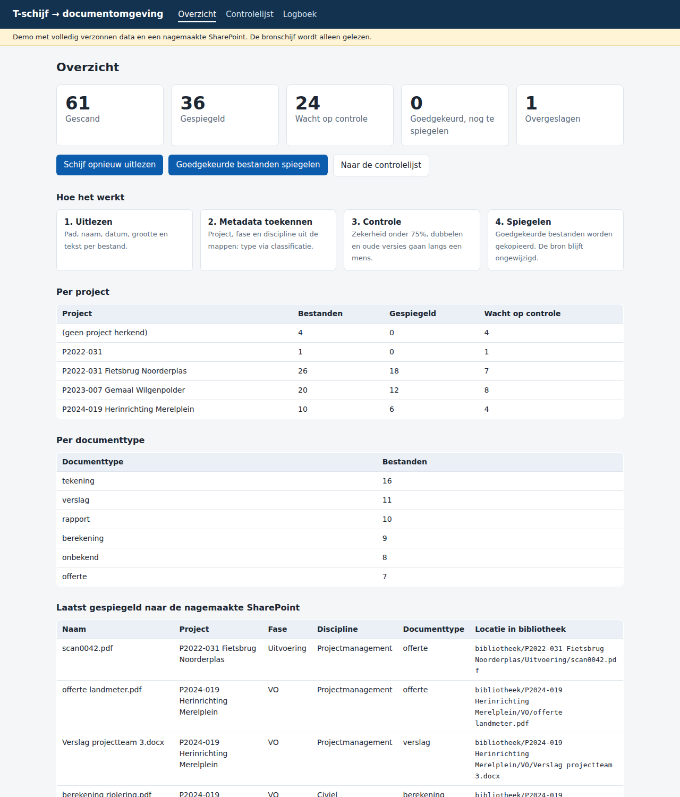
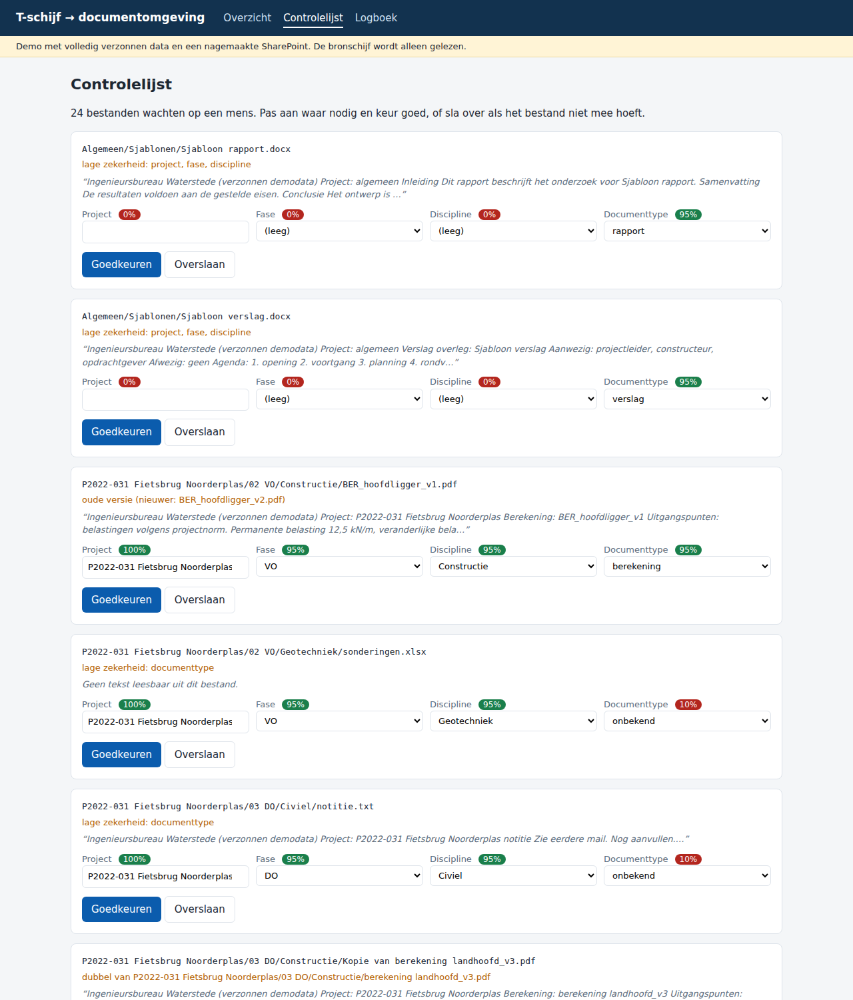
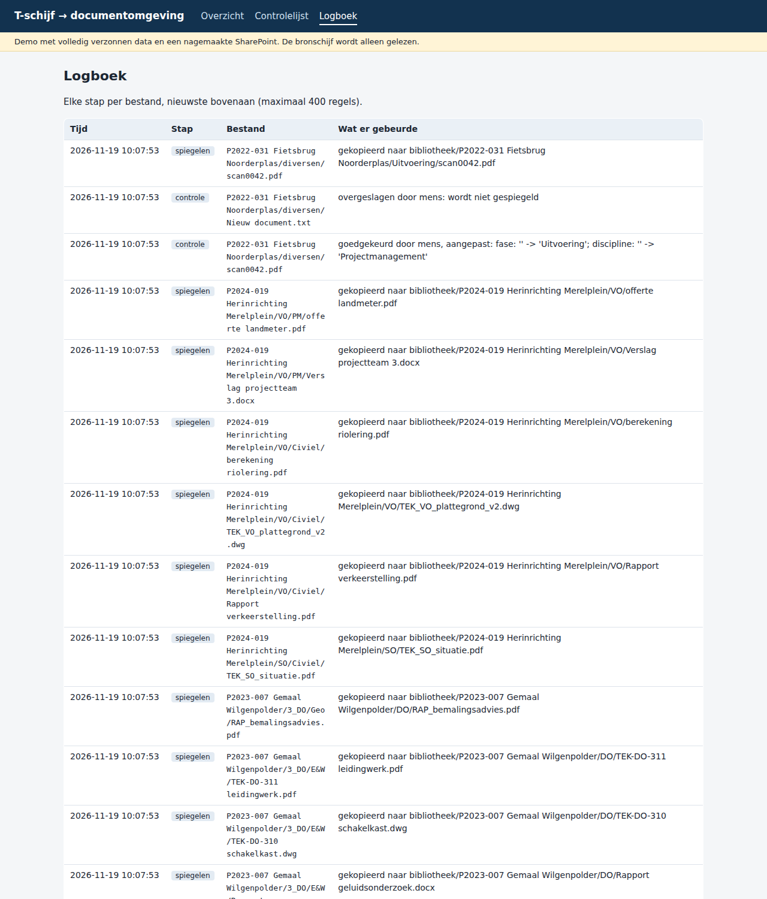

# T-schijf → documentomgeving (demo)

Een werkende demo van een tool die een netwerkschijf uitleest, elk bestand
automatisch van metadata voorziet en het daarna spiegelt naar een
documentomgeving.

**Alle data is verzonnen.** De projecten, het ingenieursbureau en de bestanden
bestaan niet. Ook het doelsysteem is nagemaakt: de "SharePoint" is een lokale
map met een SQLite-tabel. Er is geen koppeling met echte systemen.

## Starten

```sh
./start.sh
```

Open daarna <http://127.0.0.1:8010>. Het script maakt een Python-omgeving,
vult `demo-t-schijf/` met 61 verzonnen bestanden en start de webinterface.
Nodig: Python 3.11 of nieuwer. Andere poort: `PORT=9000 ./start.sh`.

## Wat de demo laat zien

1. **Uitlezen** – per bestand pad, naam, datum, grootte en (bij pdf, docx, txt) de tekst.
2. **Metadata toekennen** – project, fase en discipline volgen met vaste regels
   uit de mapstructuur. Het documenttype (tekening, rapport, offerte, verslag,
   berekening) komt uit een classificatiestap. Elk veld krijgt een zekerheidsscore.
3. **Controle** – bestanden met een score onder 75%, dubbelen en oude versies
   komen in een controlelijst. Een mens keurt goed, past aan of slaat over.
4. **Spiegelen** – goedgekeurde bestanden worden met hun metadata gekopieerd
   naar de nagemaakte SharePoint. Eén richting: de bron wordt alleen gelezen,
   er wordt nooit iets verplaatst of verwijderd.

| Overzicht | Controlelijst | Logboek |
|---|---|---|
|  |  |  |

## Opbouw

| Bestand | Rol |
|---|---|
| `maak_demodata.py` | vult `demo-t-schijf/` met verzonnen bestanden |
| `tschijf/regels.py` | regels voor project, fase en discipline uit de mappen |
| `tschijf/classificatie.py` | documenttype: `RegelClassificeerder` (standaard) en `LlmClassificeerder` |
| `tschijf/doel.py` | doelsysteem: `NepSharePoint`, plus lege `GraphSharePoint` en `AlfrescoDoel` |
| `tschijf/pijplijn.py` | de vier stappen |
| `tschijf/app.py` | webinterface (FastAPI) |

De classificatie met een taalmodel staat standaard uit. Aanzetten:
`CLASSIFICATIE=llm LLM_BASE_URL=... LLM_MODEL=... ./start.sh` (OpenAI-compatibele
API, dus ook een lokaal model). Is de dienst niet bereikbaar, dan vallen de
regels in. Deze variant is in de demo niet tegen een echt model getest.

## Tests

```sh
.venv/bin/python -m pytest
```

De tests dekken de regels uit de mapstructuur en de garantie dat de bron niet
wijzigt: na de hele keten is de bron byte voor byte gelijk (inhoud, grootte en
wijzigingsdatum), en de keten werkt ook op een bron zonder schrijfrechten.

## Wat er nodig is voor de echte versie

- Een **service-account met alleen leesrechten** op de netwerkschijf.
- Een **app-registratie voor SharePoint** (Microsoft Graph), met schrijfrecht op alleen de doelsite.
- Een **plek binnen het gemeentenetwerk** om de tool te draaien.
- Een **goedgekeurde AI-dienst of een lokaal model**, vanwege privacy. Zonder werkt de tool met alleen regels.
- Een **eigenaar voor de controle**: iemand die de controlelijst bijhoudt en de regels beheert.

Een koppeling met het archiefsysteem komt pas daarna en vraagt akkoord van
functioneel beheer.

## Beperkingen van de demo

- De regels zijn afgestemd op de verzonnen mapstructuur; een echte schijf vraagt eigen regels.
- Tekeningen (dwg), spreadsheets en afbeeldingen worden alleen op naam en map beoordeeld.
- Geen aanmelding of rechten in de webinterface.
